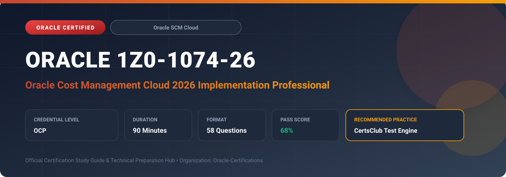

  

# Oracle 1Z0-1074-26: Oracle Cost Management Cloud 2026 Implementation Professional

---

## 1. Exam Overview & Candidate Profile

The **Oracle 1Z0-1074-26: Oracle Cost Management Cloud 2026 Implementation Professional** examination is engineered for enterprise architects, solution specialists, functional consultants, and implementation professionals seeking formal industry recognition of their proficiency in Oracle technologies.

The Oracle Cost Management Cloud 2026 Implementation Professional (1Z0-1074-26) certification confirms a professional's comprehensive capabilities in deploying, maintaining, and auditing Oracle Cost Accounting, Receipt Accounting, and Landed Cost Management. The exam tests end-to-end configuration from multi-book valuation setup to period-end reconciliations and automated subledger integrations.

### Target Audience & Prerequisites
- **Target Roles**: Implementation Specialists, Cloud Architects, Technical Leads, Enterprise Functional Consultants, and Systems Engineers.
- **Recommended Experience**: 1–2 years of practical, hands-on experience designing, implementing, and maintaining corresponding Oracle Cloud solutions.
- **Credential Earned**: Oracle Certified Professional (OCP).

---

## 2. Key Exam Specifications

| Specification | Details |
| :--- | :--- |
| **Exam Code** | **Oracle 1Z0-1074-26** |
| **Official Title** | Oracle Cost Management Cloud 2026 Implementation Professional |
| **Certification Track** | Oracle Supply Chain Management Cloud |
| **Exam Duration** | 90 Minutes |
| **Number of Questions** | 58 Questions |
| **Passing Score** | 68% |
| **Question Format** | Multiple Choice (Single/Multiple Answer), Scenario-Based Questions |
| **Delivery Provider** | Oracle University / Pearson VUE (Online Proctored or Test Center) |
| **Recommended Practice Engine** | [CertsClub Oracle Practice Tests](https://www.certsclub.com/oracle/1z0-1074-26-dumps.html) |

---

## 3. Official Blueprint & Exam Domain Breakdown

The examination assesses candidate competencies across core functional domains weighted as follows:

| Domain Area | Weighting |
| :--- | :--- |
| **Cost Accounting Structures & Cost Organization Setup** | `25%` |
| **Cost Valuation Methods (Standard, Actual, FIFO, Average)** | `25%` |
| **Landed Cost Management Setup & Charge Ingestion** | `20%` |
| **Receipt Accounting & Subledger Accounting (SLA)** | `15%` |
| **Period Close, Cost Processing & Valuation Reporting** | `15%` |

---

## 4. Deep Dive into Complex & Challenging Technical Topics

To secure a passing score on the 1Z0-1074-26 exam, candidates must master the following advanced concepts:

- Configuring multi-book valuation structures, perpetual average vs. standard cost configurations, and cost element definitions.
- Managing Landed Cost Management (LCM) trade operations, charge allocations by volume/weight/value, and invoice variance accounting.
- Receipt accrual reconciliation workflow, accrual clearing rules, and troubleshooting un-invoiced receipt balances.
- Executing cost cut-off rules, inventory valuation auditing, gross margin reconciliation, and period-end close validations.

---

## 5. Scenario-Based Demo & Practice Questions

### Question 1
In Oracle Receipt Accounting, which scheduled process must be executed first to calculate purchase order accruals and prepare receipt transactions for General Ledger posting?

A) Transfer Transactions to General Ledger
B) Create Receipt Accounting Distributions
C) Match Invoices to Receipts
D) Landed Cost Adjustment Processor

- **Correct Answer**: `B) Create Receipt Accounting Distributions`  
- **Technical Explanation**: The 'Create Receipt Accounting Distributions' process calculates accruals on received items, creates receipt accounting events, and generates subledger accounting entries before data can be transferred to the General Ledger.

---

### Question 2
Which allocation basis in Landed Cost Management is most appropriate when freight charges are assessed by the carrier strictly based on the physical weight of shipped goods?

A) Item Invoice Value
B) Unit Weight
C) Quantity Ordered
D) Unit Volume

- **Correct Answer**: `B) Unit Weight`  
- **Technical Explanation**: Landed Cost Management supports charge allocation by Value, Quantity, Volume, and Weight. For weight-based shipping tariffs, selecting Weight ensures charges are allocated proportionately according to item gross/net weight.

---

## 6. Recommended Preparation Strategy & Practice Testing Engine

Achieving certification in **Oracle 1Z0-1074-26** requires balanced theoretical study and scenario-based simulation practice:

1. **Review Oracle Documentation**: Master architecture guides, implementation workbooks, and administration manuals on the Oracle Help Center.
2. **Hands-on Lab Practice**: Execute real-world configuration, policy setup, and troubleshooting tasks in your cloud tenancy or test instance.
3. **Simulated Exam Drills**: Practice answering timed, scenario-based multiple-choice questions to familiarize yourself with the question formats, traps, and timing constraints.

### Practice With CertsClub
For realistic practice questions, updated dumps, and mock testing environments:
- **Resource**: [CertsClub Oracle Practice Test Engine](https://www.certsclub.com/oracle/1z0-1074-26-dumps.html)
- **Special Discount**: Use coupon code **`club20`** during checkout for an instant **20% discount** on all practice exam bundles and testing engines.

---

## 7. Official Documentation & References

- [Oracle University Certification Registry](https://education.oracle.com/)
- [Oracle Help Center Documentation Portal](https://docs.oracle.com/)
- [Oracle Cloud Infrastructure & Applications Guides](https://docs.oracle.com/en/cloud/)
- [CertsClub Oracle Certification Exam Practice](https://www.certsclub.com/oracle/1z0-1074-26-dumps.html)

---

## 8. SEO & Discovery Keywords

`oracle 1z0-1074-26, oracle 1z0-1074-26 exam, oracle 1z0-1074-26 dumps, 1Z0-1074-26 practice questions, 1Z0-1074-26 study guide, oracle 1z0-1074-26 syllabus, oracle cost management cloud 2026 implementation professional, certsclub 1z0-1074-26`
